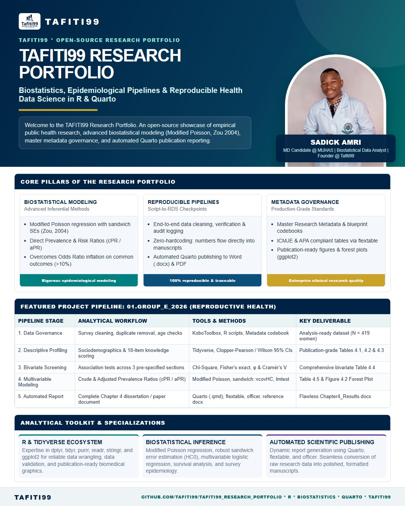

# TAFITI99 Research Portfolio

[](https://www.r-project.org/)
[](https://opensource.org/licenses/MIT)
[](https://quarto.org)
[]()

Welcome to the **TAFITI99 Research Portfolio**, curated by **Sadick Amri**. This repository showcases empirical public health investigations, biostatistical analysis pipelines, and reproducible research workflows developed using R, Quarto, and modern data science practices.

---

## 🌟 Portfolio Overview

<p align="center">
  
</p>

This repository houses end-to-end research projects covering:
- **Epidemiological & Public Health Analytics**: Cross-sectional, cohort, and observational study designs.
- **Advanced Biostatistical Modeling**: Modified Poisson regression with robust (sandwich) standard errors (Zou, 2004), multivariable logistic regression, survival analysis, and survey analytics.
- **Reproducible Research Architectures**: Script-to-RDS checkpoint pipelines, programmatic table generation (APA / ICMJE format via `flextable`), publication-grade data visualizations (`ggplot2`), and dynamic report authoring (`Quarto` / Word).
- **Master Metadata Governance**: Structured data dictionaries, codebooks, and audit trails ensuring strict traceability from raw survey captures (e.g., KoboToolbox / SPSS) to final manuscripts.

---

## 📂 Projects & Studies

| Project Folder | Title / Topic | Methodology & Key Tools | Status |
| :--- | :--- | :--- | :---: |
| [**`01.Group_E_2026`**](./01.Group_E_2026/) | **Assessment of Knowledge & Socio-Cultural Factors Affecting Modern Contraceptive Use in Mkuranga District, Pwani Region** | Modified Poisson Regression (cPR & aPR), Sandwich SEs, Quarto, Flextable, R Pipeline | **Completed** |

---

## 🔬 Featured Project Highlight: `01.Group_E_2026`

- **Context**: Reproductive health evaluation among women of childbearing age (15–49) in Mkuranga District, Tanzania.
- **Methodological Rigor**: Because the primary outcome prevalence exceeded 10%, standard odds ratios from logistic regression would substantially overestimate risk ratios. To provide unbiased effect estimates, the study implemented **Modified Poisson Regression with Huber-White Sandwich Variance Estimators** to report Crude and Adjusted Prevalence Ratios (cPR / aPR).
- **Two-Panel Stratification**:
  - *Panel A*: Complete analytical sample evaluating sociodemographic and socio-cultural factors.
  - *Panel B*: Subgroup restricted to currently married or cohabiting women evaluating spousal dynamics, partner approval, and joint decision-making.
- **Full Documentation & Pipeline**: See the dedicated [01.Group_E_2026 Project README](./01.Group_E_2026/README.md).

---

## 🛠️ Tech Stack & Analytical Toolkit

- **Languages**: `R` (v4.3+), `SPSS Syntax`
- **Tidyverse Core**: `dplyr`, `tidyr`, `purrr`, `readr`, `tibble`, `stringr`, `ggplot2`
- **Biostatistics & Econometrics**: `sandwich` (Huber-White robust standard errors), `lmtest` (Wald testing), `MASS`, `car`
- **Reporting & Document Production**: `Quarto` (`.qmd`), `flextable`, `officer`
- **Data Engineering & Governance**: Strict RDS-checkpoint caching, Excel Master Metadata sheets, audit logging

## 🚀 Replication & Master Runner

Every study in this portfolio contains an automated, single-command master runner (`run_all.R`). To replicate the featured study (`01.Group_E_2026`) from raw survey imports to final publication tables, figures, and rendered Word document:

```r
# In R / RStudio:
source("01.Group_E_2026/run_all.R")
```

Or via command line / terminal:
```bash
Rscript 01.Group_E_2026/run_all.R
```

Exact software and package versions used for this analysis are archived in [`01.Group_E_2026/session_info.txt`](./01.Group_E_2026/session_info.txt).

---

## 📄 Citation

If you use these empirical studies, biostatistical models, or reproducible research pipelines in your work or academic projects, please cite this repository:

```bibtex
@misc{amri2026tafiti99,
  author       = {Sadick Amri},
  title        = {{TAFITI99 Research Portfolio: Reproducible Biostatistics and Epidemiological Pipelines in R \& Quarto}},
  year         = {2026},
  publisher    = {GitHub},
  journal      = {GitHub repository},
  howpublished = {\url{https://github.com/tafiti99/tafiti99_research_portfolio}}
}
```

You can also use the GitHub **"Cite this repository"** button on the right sidebar via [`CITATION.cff`](./CITATION.cff).

---

## ⚖️ License

This project is licensed under the **MIT License** — see the [`LICENSE`](./LICENSE) file for details.

---

## 👤 Author & Contact

**Sadick Amri**  
- **GitHub**: [@tafiti99](https://github.com/tafiti99)  
- **Email**: [sadeneyz99@gmail.com](mailto:sadeneyz99@gmail.com)  
- **Organization / Brand**: TAFITI99 Research & Data Solutions
